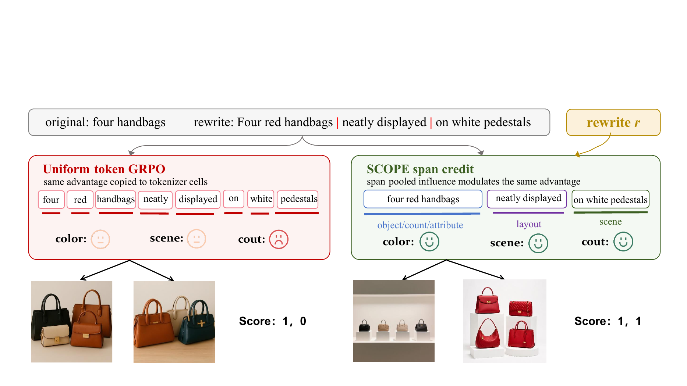
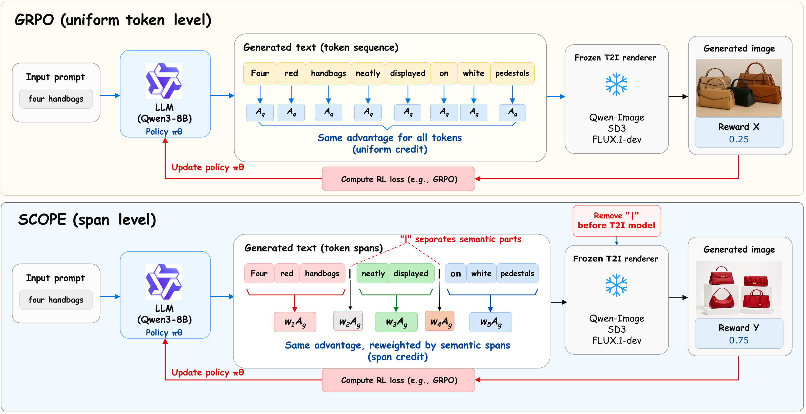
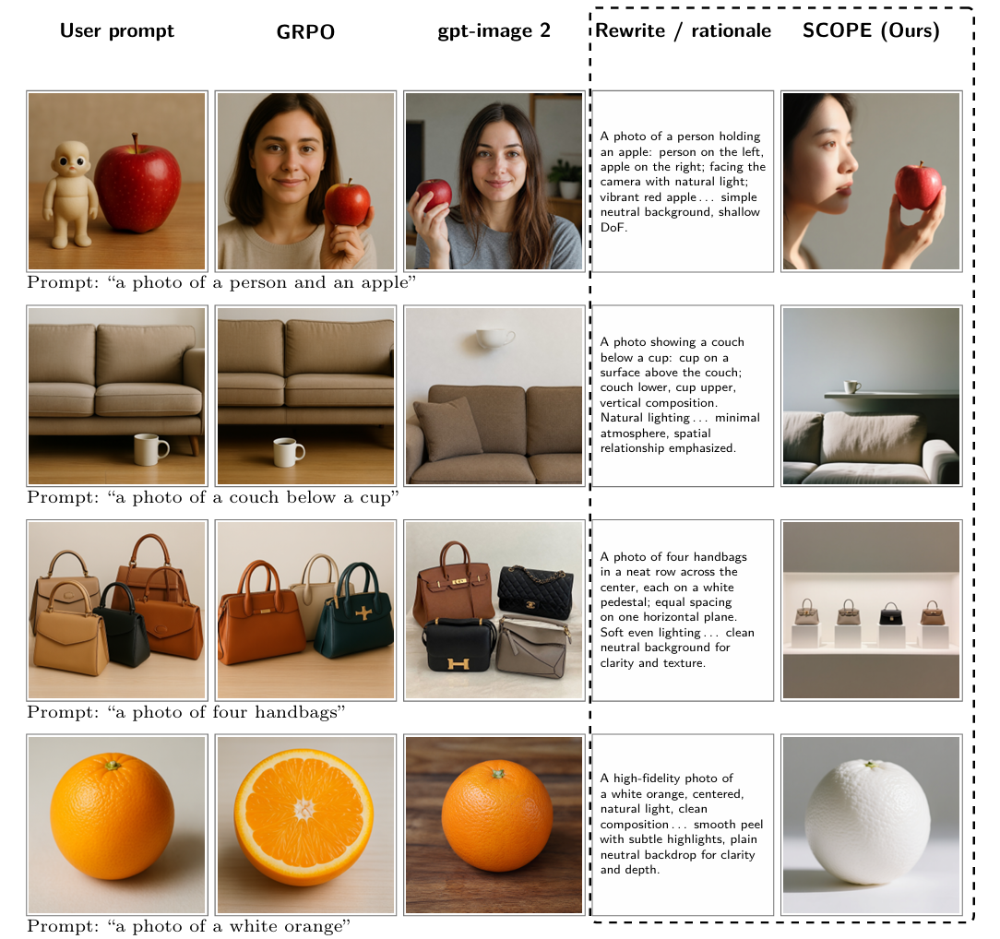
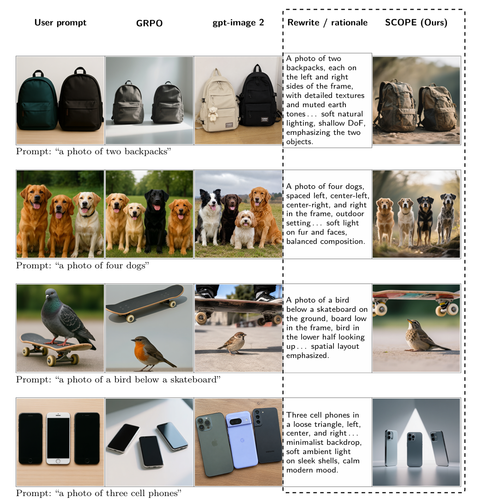

<h1 align="center">SCOPE: Semantic Bounded Credit Optimization for Prompt Engineering in Text-to-image Generation</h1>

<p align="center">
  <a href="https://github.com/MAC-AutoML/SCOPE">
    
  </a>
  <a href="https://arxiv.org/abs/2610.22264">
    
  </a>
  <a href="https://www.python.org/downloads/">
    
  </a>
</p>

<p align="center">
  <a href="#highlights">Highlights</a> /
  <a href="#installation">Installation</a> /
  <a href="#quick-start">Quick Start</a> /
  <a href="#configuration">Configuration</a> /
  <a href="#repository-structure">Repository Structure</a> /
  <a href="#citation">Citation</a>
</p>

Reinforcement learning lets a language model improve text-to-image generation by rewriting prompts for a frozen image generator. Existing methods usually apply one image-level signal to every subword token, even though objects, counts, attributes, and relations form coherent spans. SCOPE is a GRPO objective that follows this structure.

<a id="highlights"></a>
## Highlights

<p align="center">
  
  <br>
  <sub>One shared advantage, copied onto tokens in GRPO and modulated by semantic span in SCOPE.</sub>
</p>

| Piece | What it does |
| --- | --- |
| Grouped rollout | For each prompt, sample `N-1` rewrites from `pi_theta` and append the original prompt as member `N`. The original prompt is scored and used in the advantage, and it is left out of the parameter update. |
| Frozen render and score | One shared diffusion seed per group. Qwen-Image renders 512 x 512 images (20 steps, CFG 4.0). GenEval returns 0 or 1. |
| Hybrid advantage | If the original-prompt reward is below `tau` (default 1), use a clipped reward gap. Otherwise use a clipped group z-score over the `N-1` rewrites. |
| Span credit | Pool `log pi_theta - log pi_old` inside each phrase, clip the span coefficient to `[0.8, 1.2]`, and normalize phrase-token weights to mean 1. Tags and the vertical bar keep weight 1. |
| Lagged policy | `pi_old` is a frozen copy from the previous optimizer step. On step 1 it matches `pi_theta`, so every span weight is 1. |

<details open>
<summary><b>How a training step works</b></summary>

<p align="center">
  
  <br>
  <sub>Spans are removed before rendering. Coefficients reweight the shared advantage and stay detached from the gradient.</sub>
</p>

1. Sample `N-1` rewrites (`N` defaults to 8). Set member `N` to the original prompt and its advantage to 0.
2. Clean each rewrite. A valid answer-tag partition receives format reward `+0.25`; any other rewrite receives `-0.25`. The original prompt uses a fixed format reward of `+0.25`.
3. Mix the rewards with `r = w_t2i * r_image + w_fmt * r_fmt`. Both weights default to 1.
4. If `r_N < tau`, set `A = clip(r - r_N, -c, c)`. Otherwise set `A` to the clipped z-score of the `N-1` rewrites. Defaults are `c = 3` and `epsilon = 1e-6`.
5. Build span weights from the mean log-ratio inside each phrase: `clip(exp(beta * mean), 0.8, 1.2)`, then normalize. `beta` defaults to 1. A malformed, truncated, or misaligned completion falls back to weight 1 on every token.
6. Detach the weights. Clip only the probability ratio. Sum token losses inside a completion, then average over the `N-1` rewrites. An optional KL term uses the frozen initial reference with `beta = 0.01`. That reference is separate from `pi_old`.

The default learning rate is `1e-6` and the maximum completion length is 512 tokens. Multi-GPU training uses DeepSpeed ZeRO-2 from `configs/ds_zero2_bf16.json`.

</details>

<details open>
<summary><b>Qualitative results</b></summary>

Columns, from left to right: original prompt, GRPO, gpt-image 2, the SCOPE rewrite, and the SCOPE image. The dashed frame marks the rewrite and the SCOPE output.

<p align="center">
  
</p>

<p align="center">
  
</p>

</details>

<a id="installation"></a>
## 1. Installation

Linux x86_64 with NVIDIA GPUs. Python 3.10. The three roles use separate virtual environments under `.venvs/`.

```bash
bash env/roles/setup_env.sh train
bash env/roles/setup_env.sh image
bash env/roles/setup_env.sh geneval
```

`src/launch.py` runs the same installer at job start. If the requirements file is unchanged and `.venvs/ROLE/.ready` exists, installation is skipped.

| Role | Pinned stack |
| --- | --- |
| `train` | PyTorch 2.8, transformers 4.57.3, trl 0.24.0, DeepSpeed, PEFT |
| `image` | PyTorch 2.8, diffusers 0.36, FastAPI |
| `geneval` | PyTorch 2.0.1+cu118, mmcv-full 1.7.2, mmdet 2.28.2, open_clip |

The package index is PyPI. Point `SCOPE_PYTHON` at another 3.10 interpreter, or `SCOPE_PYPI_INDEX` at a mirror. `mmcv-full` comes from the OpenMMLab cu118 / torch2.0 wheel index (`MMCV_WHEEL_INDEX`). The PyTorch wheels in `env/roles/requirements-geneval.txt` point at `download.pytorch.org`. GenEval also needs `libGL`, which `env/roles/setup_native_libs.sh` unpacks into `.native`.

<a id="quick-start"></a>
## 2. Quick Start

### 2.1 Place the local weights

`MODEL_ROOT` defaults to `models/`. Training reads only local files.

| Variable | Path under `MODEL_ROOT` | Source |
| --- | --- | --- |
| `MODEL_PATH` | `Qwen/Qwen3-8B/` (`config.json`) | [Qwen/Qwen3-8B](https://huggingface.co/Qwen/Qwen3-8B) |
| `MODEL_NAME` | `Qwen/Qwen-Image/` (`model_index.json`) | [Qwen/Qwen-Image](https://huggingface.co/Qwen/Qwen-Image) |
| `GENEVAL_MODEL_PATH` | `mmdet/mask2former/mask2former_swin-s-p4-w7-224_lsj_8x2_50e_coco_20220504_001756-743b7d99.pth` | OpenMMLab MMDetection |
| `CLIP_LOCAL_PATH` | `openai/clip-vit-large-patch14/ViT-L-14.pt` | OpenAI CLIP ViT-L/14 |

`MODEL_PATH` and `MODEL_NAME` are directories. `GENEVAL_MODEL_PATH` and `CLIP_LOCAL_PATH` are weight files. A directory model may also sit in exactly one snapshot subdirectory. If more than one snapshot is present, set the variable explicitly.

```bash
# OpenAI CLIP ViT-L/14
# https://openaipublic.azureedge.net/clip/models/b8cca3fd41ae0c99ba7e8951adf17d267cdb84cd88be6f7c2e0eca1737a03836/ViT-L-14.pt

bash eval/geneval/evaluation/download_models.sh \
  models/mmdet/mask2former/mask2former_swin-s-p4-w7-224_lsj_8x2_50e_coco_20220504_001756-743b7d99.pth

python3 src/model_paths.py
```

The Mask2Former config is taken from the installed `mmdet` package. Set `GENEVAL_MODEL_CONFIG` when that lookup fails.

### 2.2 Launch the eight-node job

Every node needs 8 visible GPUs and the same `SCOPE_JOB_ID` and `SCOPE_NODE_IPS`. `SCOPE_NODE_RANK` is this node's index, from 0 to 7.

| Nodes | Role |
| --- | --- |
| 0-1 | Training, 16 GPUs in total |
| 2-6 | One Qwen-Image server per GPU |
| 7 | One GenEval server per GPU, plus the reward coordinator |

```bash
export SCOPE_JOB_ID=SCOPE-run1
export SCOPE_NODE_RANK=0
export SCOPE_NODE_IPS=10.0.0.1,10.0.0.2,10.0.0.3,10.0.0.4,10.0.0.5,10.0.0.6,10.0.0.7,10.0.0.8
export SCOPE_OUTPUT_ROOT=/path/to/outputs
bash scripts/start.sh
```

`10.0.0.1` through `10.0.0.8` above are placeholders. Replace them with the eight worker addresses. Copy the rest of the variables from `env/env.example.txt`.

Image, GenEval, and reward ports start at 18000, 17000, and 15000. Override them with `SCOPE_IMAGE_PORT`, `SCOPE_GENEVAL_PORT`, and `SCOPE_REWARD_PORT`.

### 2.3 Train against an existing reward service

Unset `REWARD_ENDPOINTS` and the trainer calls `http://127.0.0.1:5000`. The eight-node launcher sets that variable to port `15000` on node 7.

```bash
.venvs/train/bin/python src/train.py \
  --data data/geneval/train_metadata.jsonl \
  --model /path/to/Qwen3-8B \
  --outdir outputs/checkpoints \
  --num_gen 8
```

This command uses `train.py`'s default per-device batch size of 1. `scripts/start.sh` passes `PER_DEVICE_TRAIN_BATCH_SIZE`, which defaults to 8. `--num_gen` must be at least 2. `--lora` enables LoRA with `r=8` and `alpha=16`. `--no_deepspeed` turns ZeRO off. `--max_steps` and `--max_samples` truncate a trial run.

<details>
<summary><b>Job outputs</b></summary>

A job writes to `SCOPE_OUTPUT_ROOT/SCOPE_JOB_ID/`. Without `SCOPE_OUTPUT_ROOT`, that directory is `outputs/SCOPE_JOB_ID/`.

- `logs/node-RANK/`: install, service, and training logs
- `generated_images/`: images saved by the reward service
- `checkpoints/`: trainer outputs
- `service.token`: one token for this job, mode `0600`

Training starts after the authenticated health checks pass. A failed generation, score, or save marks the job `FAILED` and stops it.

</details>

<a id="configuration"></a>
## 3. Configuration

| Setting | Default | What it controls |
| --- | :---: | --- |
| `NUM_GEN` | 8 | Group size, including the original prompt |
| `PER_DEVICE_TRAIN_BATCH_SIZE` | 8 in `scripts/start.sh`, 1 in `train.py` | Prompts per GPU |
| `GRAD_ACC_STEPS` | 1 | Gradient accumulation |
| `DATA_PATH` | `data/geneval/train_metadata.jsonl` | Training JSONL |
| `REWARD_TIMEOUT` | 1800 | Reward HTTP timeout, seconds |
| `SCOPE_STARTUP_TIMEOUT` | 1800 | Time to wait for services, seconds |
| `tau`, `c`, `epsilon`, `beta` | 1, 3, `1e-6`, 1 | Hybrid advantage and span coefficient |
| KL `beta` | 0.01 | Penalty toward the initial reference |
| Learning rate | `1e-6` | Rewriter update |
| Max completion length | 512 | Rewriter generation cap |

<a id="repository-structure"></a>
## 4. Repository Structure

```text
SCOPE/
|-- assets/                     # Figures from the paper
|-- src/
|   |-- train.py                  # SCOPETrainer: rollout, advantage, span weights, update
|   |-- scope_credit.py           # Cleaning, spans, format reward, advantages, weights
|   |-- launch.py                 # Eight-node supervisor
|   |-- model_paths.py            # Local snapshot resolution
|   |-- reward_client.py          # Reward HTTP client
|   |-- reward_server.py          # Render, then GenEval, one seed per group
|   |-- image_server.py           # Local Qwen-Image server
|   |-- geneval_reward_server.py  # Mask2Former + CLIP GenEval score
|   |-- geneval_backend.py        # PyTorch fallback for MMCV attention
|   `-- service_auth.py           # Per-job bearer token
|-- scripts/start.sh              # Entry point, run on every node
|-- configs/ds_zero2_bf16.json    # DeepSpeed ZeRO-2, bf16
|-- env/
|   |-- env.example.txt           # Variables for scripts/start.sh
|   `-- roles/                    # train / image / geneval installers
|-- data/
|   |-- geneval/                  # Default training JSONL and GenEval-format T2I rows
|   `-- T2I-CompBench/            # Training prompt texts (*_train.txt)
`-- eval/
    |-- geneval/                  # Upstream GenEval code and prompts
    `-- T2I-CompBench/            # Upstream T2I-CompBench / T2I-CompBench++
```

`data/geneval/train_metadata.jsonl` is the default training set. Each row has `prompt`, `tag`, and `include`. Counting samples also have `exclude`. `data/geneval/t2i_compbench_train_metadata.jsonl` adds `source` and `source_index` and is still scored with GenEval. The matching raw prompts are `data/T2I-CompBench/*_train.txt`.

## 5. Acknowledgements

Training uses [Qwen3-8B](https://huggingface.co/Qwen/Qwen3-8B), [Qwen-Image](https://huggingface.co/Qwen/Qwen-Image), [Stable Diffusion 3](https://huggingface.co/stabilityai/stable-diffusion-3-medium), and [FLUX.1-dev](https://huggingface.co/black-forest-labs/FLUX.1-dev), together with [TRL](https://github.com/huggingface/trl) 0.24 GRPO, [GenEval](https://github.com/djghosh13/geneval), and [T2I-CompBench](https://github.com/Karine-Huang/T2I-CompBench). Upstream benchmark code under `eval/` keeps the licenses shipped with those projects.

<a id="citation"></a>
## 6. Citation

If you use this repository, please cite the corresponding paper:

```bibtex
@misc{jiao2026scopesemanticboundedcredit,
  title={SCOPE: Semantic Bounded Credit Optimization for Prompt Engineering in Text-to-image Generation},
  author={Yufei Jiao and Jinfa Huang and Zeyue Xue and Tianyu Xie and Yuexiao Ma and Rongrong Ji and Xiawu Zheng and Jiebo Luo},
  year={2026},
  eprint={2610.22264},
  archivePrefix={arXiv},
  primaryClass={cs.CV},
  url={https://arxiv.org/abs/2610.22264},
}
```
